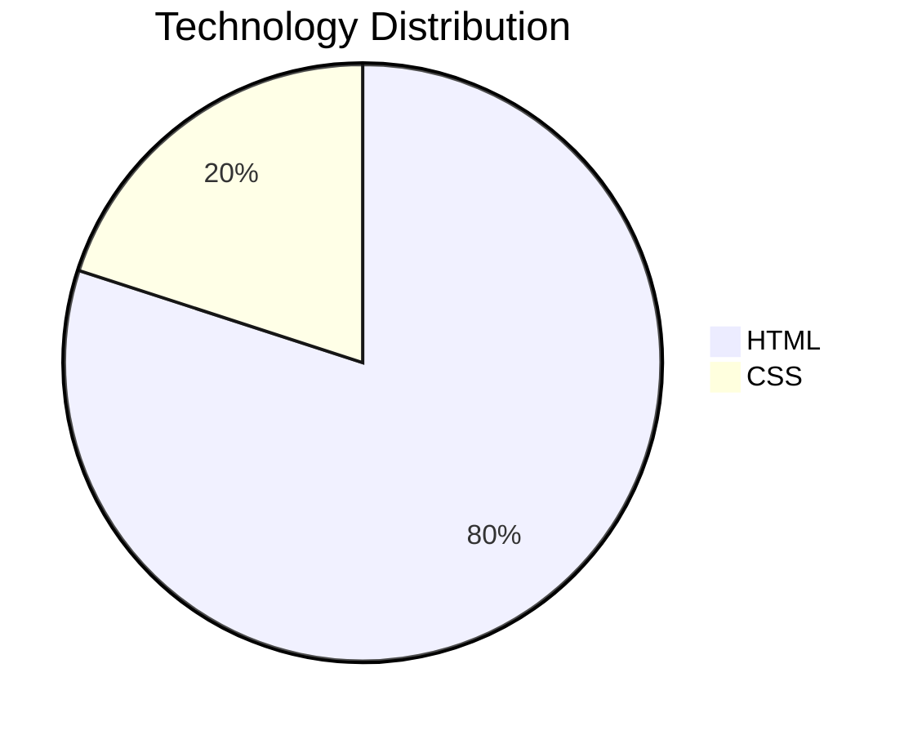

# Office Locations Update Prototype

A lightweight web prototype built to visualize proposed office location updates in a clear, interactive, and review-friendly format.

## Live Preview

[View Prototype](https://uday-meteoros.github.io/office-locations-update.html/)

## Overview

Sometimes a working prototype communicates ideas more effectively than documents, screenshots, or lengthy explanations.

This project was created to transform proposed office location updates into a browser-based experience, enabling clearer discussions, easier reviews, and faster implementation.

### What's Included

- Refined office location presentation
- Enhanced contact information layout
- Improved readability and information hierarchy
- Proposed content and structure updates

## Why This Project?

Rather than describing changes through notes or static mockups, this prototype demonstrates them in a functional format, helping bridge the gap between requirements and implementation.

## Key Contributions

- Converted requirements into a functional prototype
- Created an interactive visual reference
- Improved communication of proposed updates
- Simplified stakeholder review and feedback
- Delivered a browser-ready proof of concept

## Technology Breakdown

```text
HTML          ████████████████ 80%
CSS           ████             20%
GitHub Pages  Deployment
```



## Design Approach

The goal was to create a lightweight, browser-based prototype that could be easily shared, reviewed, and iterated upon. By converting requirements into a working implementation, proposed changes could be visualized immediately without requiring access to design tools or production environments.

## Project Philosophy

> Build first. Discuss better. Implement faster.

## Author

**Uday Somapuram**

Technology Consultant | AI, Cloud & Full-Stack Enthusiast
